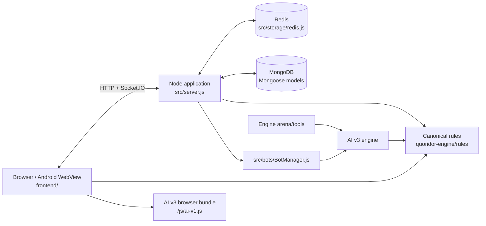

# AI Architecture Reference

> Snapshot: source archive inspected 2026-11-10. This is a static code map, not a production runtime certification.

## 1. Runtime topology

The frontend is served by Express from `frontend/`; no separate frontend build pipeline is evident in the package scripts. Socket.IO shares the application server. Docker Compose defines app, MongoDB, Redis and persistent volumes; production TLS/reverse proxy is documented separately in `DEPLOY.md`.

## 2. Entrypoints and boot sequence

- `package.json.main`: `src/server.js`.
- `npm start`: `node src/server.js`.
- `npm run dev`: `nodemon src/server.js`.
- `src/server.js` exports/starts the application through `startServer` (inspect its bottom section before changing lifecycle behavior).
- `src/storage/db.js` exports `connectDB`; it attempts Mongoose connection using `MONGO_URI` or localhost default and logs a connection failure rather than throwing from the catch block.
- `src/storage/redis.js` owns Redis connection and the in-memory fallback implementation.
- `src/core/ai-v1-bundle.js` reads engine v3, personality and RNG source files, constructs a browser-compatible script string and caches it in memory. Restart the server after changing bundle source; browser cache versions are separately declared in HTML.

**Important:** root `server.js` exists but package scripts do not point to it. Treat it as legacy/alternate until its use is explicitly confirmed.

## 3. Major backend areas

| Area | Files | Responsibility |
|---|---|---|
| Application orchestration | `src/server.js` | Express setup, routes, Socket.IO, authentication/session integration, matchmaking, game lifecycle, timers, finalization, admin operations |
| Auth provider | `src/auth/google.js` | Google authentication helper; routes are wired in `src/server.js` |
| Rules bridge | `src/core/shared.js` | CommonJS re-export of canonical rules |
| Browser AI build | `src/core/ai-v1-bundle.js` | Runtime bundle generator for engine v3 and browser global |
| Legacy AI | `src/core/ai-core.js` | Legacy baseline; verify call sites before modifying |
| Redis abstraction | `src/storage/redis.js` | Games, active-game index, locks, queues, rooms, tokens, disconnect/turn timers, rematch contexts, finished-game snapshots, bot encounter counters; memory fallback |
| Mongo connection | `src/storage/db.js` | Mongoose connection |
| Bot execution | `src/bots/BotManager.js` | Bot engine creation, opponent candidate selection and scheduled server bot turns |
| Bot presence | `src/bots/BotPresenceManager.js` | Simulated bot online/activity presence |
| Bot selection | `src/bots/matchmaking.js` | Deterministic helper for selecting a bot candidate |
| Bot population | `src/simulation/PopulationManager.js` | Synchronizes bot accounts using seed data |
| Utilities | `src/utils/logger.js`, `src/utils/mailer.js` | Logging and email delivery |

## 4. Frontend architecture

`frontend/index.html` is the main application shell. Its script sequence includes analytics, UI, networking, shared rules, evaluation helpers, undo, AI worker bridge, AI bundle, board renderer and game controller. Do not reorder scripts casually: dependencies are exposed as browser globals and the shared rules must exist before the AI v3 bundle executes.

| File | Responsibility (high-level) |
|---|---|
| `frontend/js/ui.js` | Main UI controller, menus, overlays, profile/social/admin-related UI and screen state; large file, locate exact functions before editing |
| `frontend/js/net.js` | Socket.IO client connection and event bridge |
| `frontend/js/game.js` | Main board/game interaction and rendering coordination |
| `frontend/js/board-renderer.js` | Board drawing/rendering helpers |
| `frontend/js/ai.js` | Client AI orchestration / worker interface |
| `frontend/js/ai-worker.js` | AI worker execution |
| `frontend/js/eval-shared.js` | Shared evaluation utilities |
| `frontend/js/game-eval-worker.js` | Game evaluation worker |
| `frontend/js/replay.js` | Replay loading, navigation, analysis and video export |
| `frontend/js/replay-eval-worker.js` | Replay evaluation worker |
| `frontend/js/game-undo.js` | Undo-related client helper |
| `frontend/js/analytics.js` | Client analytics event collection/submission |
| `frontend/js/site-shell.js` | Shared site shell behavior for standalone pages |

The frontend is multi-page: `index.html` is the game shell; separate HTML pages cover authentication, rules/help/legal, reports, leaderboard, replay and administration. See `docs/AI_FRONTEND.md` for the file inventory.

## 5. Shared rules and browser AI integration

- Canonical rules are in `quoridor-engine/rules/`.
- `src/core/shared.js` simply requires `../../quoridor-engine/rules` for Node consumers.
- The backend serves the canonical UMD rules file at `/shared.js` (route in `src/server.js`). The browser receives it as global `Shared`.
- `src/core/ai-v1-bundle.js` embeds `quoridor-engine/tools/rng.js`, `quoridor-engine/engines/v3/index.js`, and `quoridor-engine/engines/personality.js` into a small runtime module registry. Its historical external name remains `AiV1` and URL `/js/ai-v1.js`; `createEngineV1` aliases `createEngineV3` for compatibility.
- Current depth mapping in the bundler: `easy: 4`, `medium: 6`, `hard: 8`, `impossible: 56`; unknown labels use default depth 3. Verify this file before changing difficulty semantics.

## 6. Data ownership

- MongoDB/Mongoose: durable account and product data (models under `src/models/`).
- Redis abstraction: ephemeral/realtime state and coordination. The wrapper has an in-memory mode, so behavior under fallback may differ from multi-process Redis behavior.
- Browser: presentation and local play/replay/AI interaction. Online moves must still be validated by server-side rules.

See `docs/AI_DATA.md` and `docs/WS_PROTOCOL.md`.

## 7. Known architectural risk areas

1. `src/server.js` is a large monolith; a change to one route can share helpers/state with unrelated features.
2. `frontend/js/ui.js` and `frontend/js/game.js` are large files. Search for function definitions and call sites rather than reading only the first section.
3. Browser globals and script order are implicit module boundaries.
4. Root `server.js` can confuse agents; package scripts establish `src/server.js` as the active entrypoint.
5. Redis fallback can conceal deployment/configuration problems in local tests; test Redis-specific behavior explicitly when relevant.
6. Historical documentation (old architecture maps, plans, reports) has been removed from the repository; only the files listed in `docs/AI_DOCS_README.md` are current.
